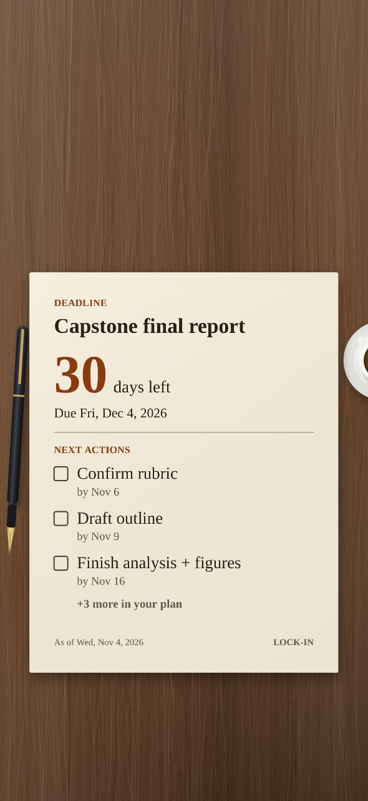
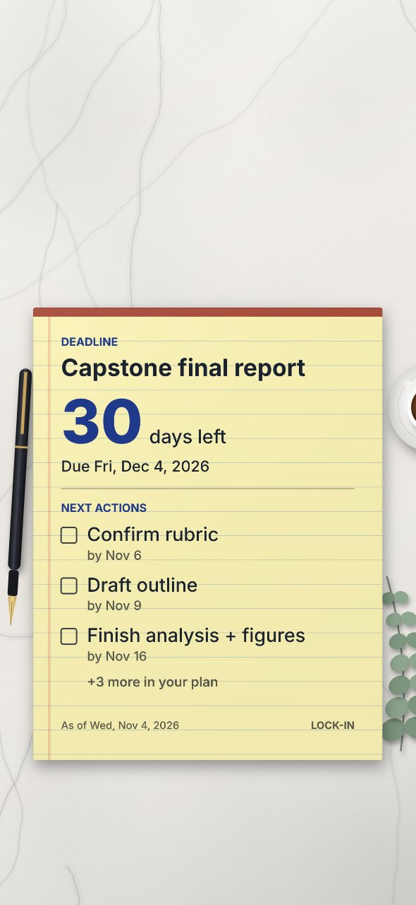
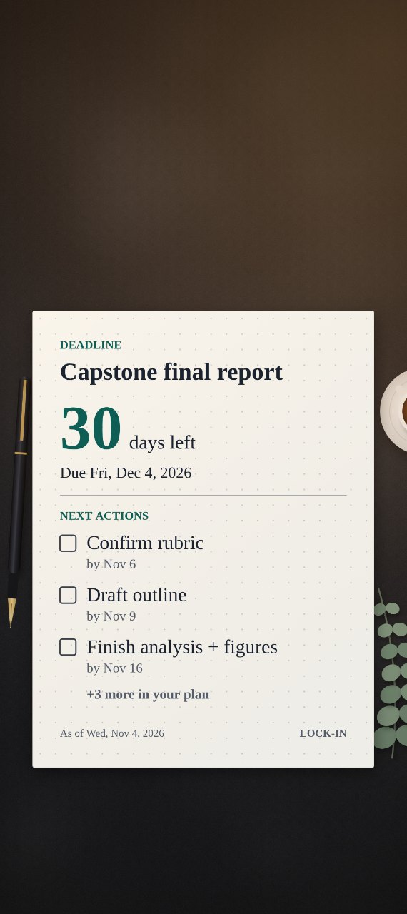
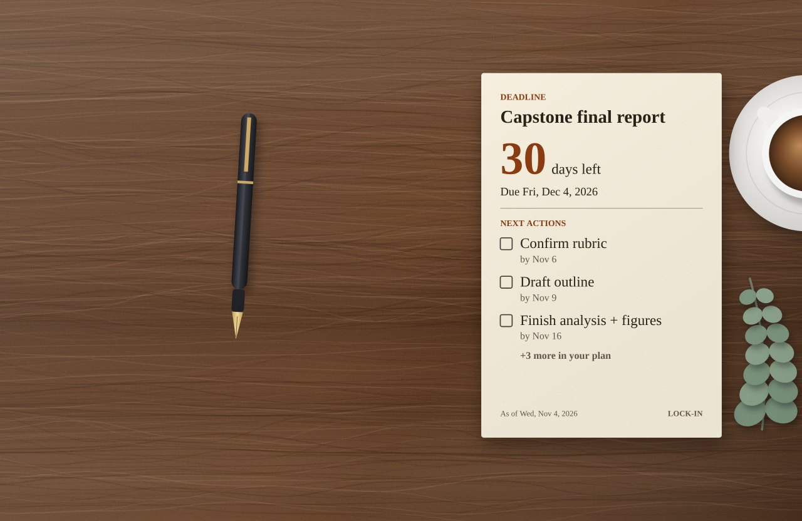

# Lock-In: Countdown Lock Screen Studio

**Plan backward from one deadline with Gemini and turn the plan into a readable desk-and-paper lock screen. Then schedule the reminders that keep you on track.**

Built for the Handshake × Google mission [*Your Deadline, Your Design: Create a Countdown Lock Screen*](https://joinhandshake.com/learn/your-deadline-your-design-create-a-countdown-lock-screen-e748e649/).

<p align="center">
  
  
  
</p>
<p align="center">
  
</p>

> The deadlines in these images are fictional sample data.

---

## For judges: the 3-minute tour

**Run it.** No install, accounts or API keys needed:

```bash
npm start
```

Then open <http://localhost:8080/?sample>. With no Node.js, `python3 -m http.server 8080` in the repo folder works too. The app must be served over HTTP; opening `index.html` directly from disk won't load its modules.

`?sample` loads a fictional deadline ("Capstone final report", 30 days out) with six planned actions. Then walk the six tabs:

| Tab | What to try | What it shows |
|---|---|---|
| **1 Deadline** | Switch between *Date only* and *Specific time*, change the timezone | Correct calendar-day countdown semantics |
| **2 Plan** | Copy the Gemini prompt; paste a plan into *Paste the plan you accepted*; tick an action done | Backward planning; completed actions leave the wallpaper |
| **3 Design** | Change device, desk, paper and lighting; drag the paper sliders into the clock area | Device-formatted design and readability warnings |
| **4 Install** | Download PNG, then confirm installation; go back and edit a task | Exported ≠ installed; the status turns "out of date" |
| **5 Reminders** | Download the `.ics` or click *Add to Google Calendar*; tick *Seen in my calendar* | Reminder scheduling that is actually verified |
| **6 Review** | Step through the challenge checklist | Evidence collected automatically from your data |

To see the readability rules at work, open **Plan**, clear an action's *short label*, and give it a very long title. The preview flags it and offers a **Fix** link. The text never shrinks below the minimum readable size.

---

## How it meets the mission

The mission names three learning outcomes. Lock-In treats all three as product features, not decoration.

| Mission outcome | How Lock-In delivers it |
|---|---|
| **Backward planning with Gemini** | Tab 2 builds the planning prompt from your goal, deadline, timezone, today's date and your constraints. It asks Gemini for a dated plan with a review buffer, for missing information instead of invented commitments, and for three short lock-screen labels. Paste the reply back and Lock-In parses the dates (ISO, "Nov 12", "11/12", tables, checklists). You review every action before it's added. |
| **Lock-screen design formatted for a device** | Real pixel dimensions for 15 phone and computer presets plus custom sizes. A calibratable paper rectangle, clock/shortcut guide overlays and overlap warnings. Text is drawn by the app at fixed coordinates, so every date and label is exactly right. |
| **Reminder scheduling** | Tab 5 turns the accepted plan into reminders: one per dated action, the deadline itself with a 24-hour alert, and an optional "refresh your wallpaper" repeat. Export as `.ics` (with alerts) or open prefilled Google Calendar events. A reminder only counts once you tick *Seen in my calendar*. If the plan changes afterwards, that tick is invalidated. |

### Where Gemini is used, honestly

1. **Planning (required path).** You run the planning prompt in the Gemini app. Lock-In writes the prompt and imports the result, but never calls Gemini for planning itself.
2. **Scenery (optional).** An image model can generate the *desk background only*. Generate it in the Gemini app (download the image, then *Upload image…*), or generate it in-app with your own API key (BYOK). In-app, **you choose the provider/API and the model**: the Google Gemini API (Gemini image models or Imagen), the OpenAI Images API, or any OpenAI-compatible endpoint at a URL you enter. Gemini is the default. Lock-In always draws the paper, text and checkboxes itself.
3. **Not used** for task edits, countdown changes or re-exports. Those are re-composited locally in milliseconds, with no AI call and no cost.

Why Gemini doesn't draw the text: image models can't guarantee correct dates, consistent paper placement or legible small text. A countdown that's off by a day defeats the purpose. So the design doc's "full AI render" mode is kept as a deferred experiment, and the functional renderer is deterministic.

---

## Key design decisions

**One deadline, a few actions.** The lock screen shows one deadline title, a big countdown, the exact due date, up to three next actions (configurable to six, with a readability warning), a "+N more" overflow count, and an **"As of" date**. A wallpaper is a snapshot, not a running timer, so the image always says when it was true.

**Countdown semantics** (`src/dates.js`):
- *Date-only* deadlines count remaining **calendar days in the chosen timezone**: "Due today" on the date, "Overdue" after it.
- *Timed* deadlines store the exact instant and a display timezone, and become "Overdue" the moment it passes.
- Days are computed from calendar dates, never by dividing seconds by 86,400, so daylight-saving changes can't cause off-by-one errors. Unit tests cover the 2026 US DST transitions.

**Which actions appear.** Pinned actions come first, in your order, and are never silently replaced. The rest are ordered by due date (earliest first, undated last), then priority, then manual order. Completed actions drop off the next export.

**Readability over cramming** (`src/layout.js`):
- Body text starts proportional to the paper size.
- It may shrink only down to a minimum readable size: 3.6% of the screen's short side on phones (about 14 pt on an iPhone) and 2.2% on computers.
- Labels wrap to two lines at most. Anything longer is ellipsised and flagged so you can write a short label; the full title stays in your plan.
- If content still doesn't fit, trailing actions move into "+N more" instead of the text getting smaller.

**Truthful state** (`src/store.js`). Lock-In tracks *generated → exported → installed* separately. A web page can't see your lock screen, so "installed" is only recorded after you confirm it, with a three-point on-device checklist. The app then compares a hash of what's on the image against what *would* be on it now. It tells you when the installed wallpaper is out of date because of a changed plan or a midnight rollover. It never claims to be "synced".

**Offline and private by default.**
- Bundled desks (Warm Walnut, Matte Black Executive, White Carrara Marble) are drawn procedurally with seeded randomness, so no image assets, network or key are needed.
- When served from a real host (such as GitHub Pages), a service worker caches the app after the first visit. It is skipped on localhost so development edits show up immediately.
- All data lives in your browser (`localStorage` plus IndexedDB for custom backgrounds). There's no server, account or analytics.

**Bring your own key, your own provider, your own model** (`src/ai.js`):
- **Provider / API:** pick *Google Gemini API*, *OpenAI Images API*, or *OpenAI-compatible endpoint* (any service implementing `POST {base URL}/images/generations`, such as a self-hosted server). Custom base URLs must use `https://`; `http://` is allowed only for `localhost`.
- **Model:** type any model ID, or click *Load available models* to fetch the list your key can actually use (image models first; tick *Include non-image models* to see everything). Your choice is remembered per provider. Defaults are only starting points (`gemini-2.5-flash-image`, `gpt-image-1`).
- Lock-In builds the right request for the model: Gemini image models via `generateContent` with the nearest supported aspect ratio, Imagen via `predict`, and OpenAI-style models via `images/generations` with an orientation-matched size (override it in *Image size*).
- The key is held in memory only. It is never written to storage, backups, logs or URLs (it travels in the provider's auth header), and it's forgotten on reload. **Switching provider or base URL clears the key**, so a key can never be sent to a different service by accident.
- Requests contain only the style prompt; none of your tasks or deadline.
- *Verify connection* checks the model before you generate.
- Invalid key, quota, network, timeout and safety-blocked responses each get a clear message, and the current background is never discarded.
- A new image is previewed as a candidate. Lock-In checks whether the clock and shortcut areas look busy, and you choose to use it or discard it.
- Any charges are billed to the account that owns the key.

---

## Design document traceability

The full design doc is in [`docs/DESIGN_DOC.md`](docs/DESIGN_DOC.md). Its §8 task list maps to this implementation as follows.

**Platform decision.** The doc tells the team to "use the framework the team can ship and debug reliably." It also scopes the challenge deliverable as a lock-screen *image* for a phone or computer. So Lock-In ships as a **zero-dependency installable web app (PWA)** that runs on phones and computers alike, not as a native iOS/Android app. Native-only features are listed as not implemented below.

| Doc task | Status |
|---|---|
| 2: Deadline + target device | ✅ Date-only/timed deadlines, IANA timezones, 15 presets + custom size |
| 3: Backward plan with Gemini | ✅ §6.1 prompt (verbatim template), plan import with review |
| 4: Desk-and-paper design | ✅ Deterministic compositor, 3 desks, 4 papers, 3 typefaces, 2 lighting moods, 3 accessories |
| 5: Install and inspect | ✅ Export/share, per-platform instructions, guide overlays, user-confirmed install checklist |
| 6: Schedule and verify reminders | ✅ `.ics` with alerts, Google Calendar links, per-item verification with invalidation |
| 1, 7, 8: Verify brief / evidence / submit | 🟡 Checklist and notes in the Review tab; these are human steps on Handshake |
| 11: Local tasks + deadline model | ✅ Persistence, completion, priority, pinning, short labels, restart-safe |
| 12: Deterministic composition + bundled presets | ✅ Offline, no key needed; calibration, wrapping, overflow |
| 13: Limited aesthetic customizer | ✅ |
| 14: BYOK scenery | ✅ User-chosen provider (Gemini API, OpenAI, OpenAI-compatible URL) and model (typed or loaded from the provider), verify, memory-only key, failure handling, caching (IndexedDB) |
| 15: Wallpaper state handling | ✅ Generated / exported / installed (user-confirmed) / out-of-date |
| 9, 10: Native platform proof + scaffold | ⛔ Not done: replaced by the PWA decision above |
| 16: Native lock-screen widget | ⛔ Not implemented (needs WidgetKit / Glance) |
| 17: Read-only Google Calendar import | ⛔ Not implemented (needs OAuth client + verification) |
| 19–23: Two-way sync, more platforms, full catalog, AI full-render mode | ⛔ Deferred, as in the design doc |

The doc's §3.2, §3.3, §4.2, §4.3 and §5.1 rules (content limits, countdown semantics, app-owned geometry, BYOK boundary, freshness contract) are all implemented.

---

## What was and wasn't verified

**Verified in this repository:**
- `npm test`: 43 unit tests covering countdown/DST semantics, task selection, layout limits (minimum size, overflow, ellipsis, bounds), plan parsing, prompt templates, `.ics` generation (RFC 5545 escaping and 75-octet folding), Google Calendar links, storage fallback, snapshot state, and the image-provider client (request shapes per provider and model, model listing, base-URL validation, key handling and error mapping) against mocked APIs.
- `npm run screenshots`: a headless-Chromium end-to-end run. It loads sample data at a fixed date, adds and completes a task, changes design, exports a PNG, confirms installation, checks the out-of-date detection, downloads the `.ics`, reloads to check persistence, and exercises the BYOK flow against **mocked** Gemini, Imagen and OpenAI APIs: loading and picking a model, verifying, generating, and switching provider. It checks that requests contain no task text, that each key goes only to its own provider, that switching provider clears the key, that keys never reach storage, that insecure custom URLs are refused, that a 429 keeps the current background, and that phone width has no horizontal scroll. It writes the images in `docs/images/`.

**Not verified here (please check before relying on them):**
- **Live API calls.** No real Gemini, OpenAI or third-party endpoint was called; request formats follow each provider's documented API. Model availability and pricing change, so use *Load available models* and *Verify connection*. Some third-party endpoints don't allow browser requests (CORS); Lock-In reports that clearly when it happens.
- **Installation on physical devices.** Device presets are starting points; confirm on your own phone or computer with your clock style and widgets.
- **The mission's submission requirements.** The deadline, required uploads and judging criteria come from the signed-in Handshake mission page. The November 23, 2026 date in the original design notes is **unverified**. The Review tab reminds you to check the mission page.

---

## Project structure

```
index.html, styles.css        UI shell (six-step flow + live preview)
src/app.js                    Controller: state ↔ UI ↔ renderer
src/dates.js                  Timezone-aware countdown semantics
src/tasks.js                  Task model and visible-action selection
src/layout.js                 Deterministic sheet layout (pure, tested)
src/render/compositor.js      Background + paper + text → device-sized canvas
src/render/backgrounds.js     Procedural desks, accessories, lighting
src/prompts.js                Gemini planning and scenery templates (design doc §6)
src/plan-import.js            Parse a pasted Gemini plan into dated actions
src/reminders.js              Reminder items, .ics export, Google Calendar links
src/store.js                  Persistence, migration, snapshot lifecycle
src/ai.js                     Optional BYOK scenery client (choose provider + model)
src/idb.js                    IndexedDB storage for background images
sw.js, manifest.webmanifest   Offline support and installability
tests/                        Node unit tests (node:test, no dependencies)
scripts/serve.js              Local static server (npm start)
scripts/screenshots.cjs       Browser smoke test + docs images (Playwright)
docs/DESIGN_DOC.md            Revised design document
```

There are no runtime or build dependencies. The app is plain ES modules, so the source in this repository is exactly what runs.

### Deploying

`.github/workflows/pages.yml` runs the tests and publishes the app to GitHub Pages on every push to `main`. Enable it once under **Settings → Pages → Source: GitHub Actions**. `.github/workflows/ci.yml` runs the unit tests on every push and pull request.

## Privacy

Lock-In has no backend. Your deadline, plan, reminders and images stay in your browser until you export them. *Erase all data* in the Review tab removes everything. Backups (`.json`) never contain an API key. Background images are not included in backups.

## License

MIT. See [LICENSE](LICENSE).
